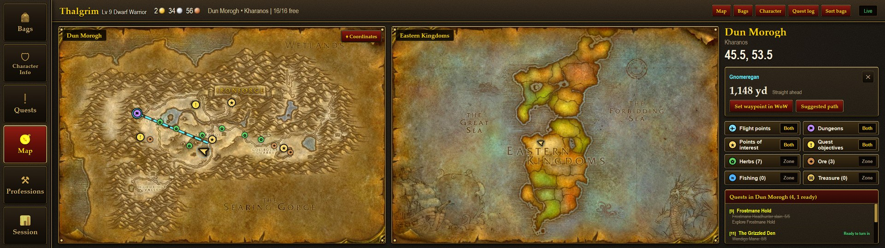
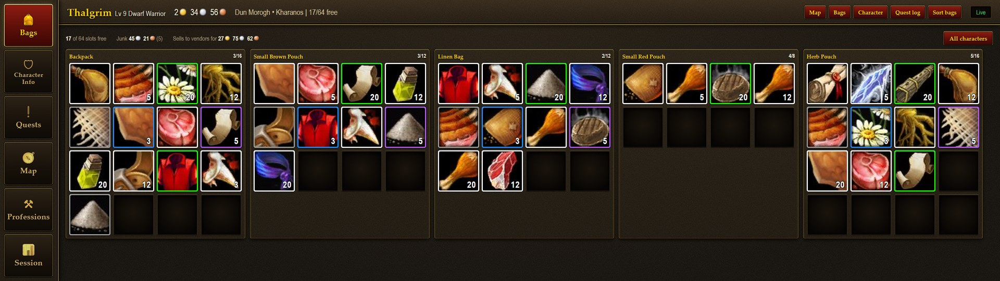
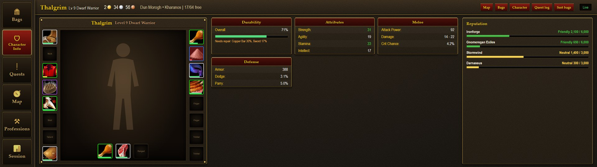
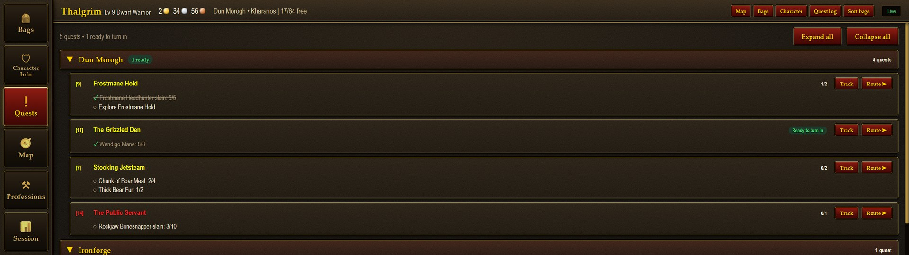
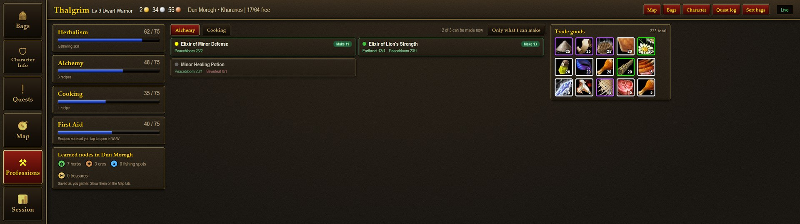
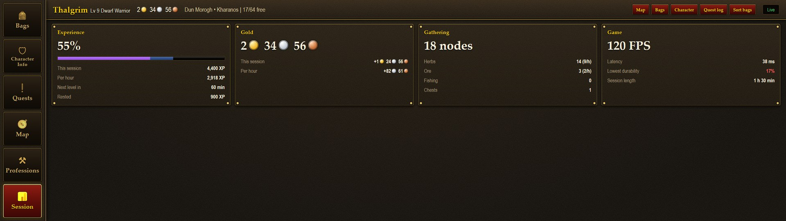

# EdgeLink

Touch panels for **World of Warcraft: Forever** on the **Corsair Xeneon Edge** (2560x720): bags, gear, quests, a live map with routes, professions and session stats.



**[Download the latest release](https://github.com/ultimateunraid/EdgeLink/releases/latest)**

EdgeLink is free and open source (MIT). It is a hobby project, not affiliated with or endorsed by Blizzard Entertainment, Corsair or Elgato.

## Screenshots

The panel fills the Edge at 2560x720 and is styled after the game's own interface. These were taken with sample data.

**Bags** - every bag on one screen, with vendor value and junk totals.



**Character Info** - equipped items with durability, stats and reputations.



**Quests** - the quest log by zone in the in-game difficulty colours, with Track and Route buttons.



**Professions** - skill levels, what you can make right now, and your materials.



**Session** - XP and gold per hour, time to level, gathering counts, FPS and latency.



## Read this first: how it works, and the risk

WoW addons cannot talk to other programs. EdgeLink gets around that in a way you should understand before installing:

1. The **addon** draws a thin strip of coloured pixels (640x4) in the top-left corner of the game window. The strip encodes your bags, quests, position and so on.
2. The **companion app** (`EdgeLink.exe`, in the system tray) captures only that strip from the screen, decodes it, and serves it on `localhost:8787`.
3. The **iCUE widget** on the Edge shows the data.

Optionally, taps on the Edge can do things in WoW (track a quest, set a map waypoint, open a window). That works by the companion sending a short burst of Ctrl+Shift+F-key presses that the addon understands. It is **off by default**; you turn it on in the tray menu.

What EdgeLink does **not** do: read game memory, inject code, touch network traffic, move your character, or do anything in combat. Game data is only published out of combat, and one tap does one interface action.

Even so, a program that reads the game window and can send keys is a grey area under Blizzard's terms, and Blizzard decides what is acceptable. **Use it at your own risk.**

## Requirements

- Windows 10 or 11 with .NET Framework 4.8 (included in Windows)
- WoW Forever
- Corsair iCUE 5.47 or newer and a Xeneon Edge
- The game window must be visible on a monitor (the strip has to be on screen)

Optional addons: **Auctionator** or **Auctioneer** (auction values for your bags), **TomTom** (its waypoints appear on the Edge map) and **Polestar** (its routes appear on the Edge map; experimental).

## Install

1. Download `EdgeLink-Setup-<version>.exe` from the [latest release](https://github.com/ultimateunraid/EdgeLink/releases/latest) and run it. It installs for your Windows user only, so there is no administrator prompt.
2. Setup copies the tray app, installs the WoW addon into your game folder, and can start EdgeLink with Windows.
3. On the last page, leave **Add the widget to iCUE** ticked. iCUE opens its import prompt: accept it, then add the widget to the Edge at full width. iCUE has no silent install for widgets, so this one step is yours.
4. Log in to WoW (or type `/reload`).

Prefer not to run an installer? Each release also has a zip: unzip it anywhere, run `EdgeLink.exe`, and use the tray menu (**Install / update WoW addon**, **Install widget in iCUE**).

Code signing with Azure Artifact Signing is being set up; until the first signed release, Windows SmartScreen or your antivirus may warn about or quarantine the setup program or `EdgeLink.exe`. See the [Code signing policy](CODE_SIGNING_POLICY.md). You can also build it yourself (below).

## What you get

| Tab | Contents |
|---|---|
| Bags | Every bag on one screen, vendor and auction value, junk total, and an all-characters view of bags and bank |
| Character Info | Equipped items with durability, your stats, and reputations |
| Quests | Quest log by zone with Track and Route buttons; quests ready to hand in are grouped at the top, with **Route to nearest turn-in** |
| Map | Zone map with your live position, a browsable world map (tap a region to open it), flight points, points of interest, learned herb and ore nodes (with a **Loop** that plans a round trip through every node in the zone), rare alerts, coordinates entry, routes, and your **friends**: group members as class-coloured dots you can route to, online friends and Battle.net friends counted on the zone they are in |
| Professions | Skill levels, recipes with how many you can make from your bags and bank, a **shopping list** of what you are still missing, and materials |
| Session | XP and gold per hour, time to level, gathering counts, FPS, latency, durability |

The header shows your Hearthstone (where it is set and its cooldown), rested XP, new mail and an estimate of your repair bill. With **Auto tabs** on, the panel switches to Bags when a vendor or the bank opens, to Professions when a profession window opens, and to the Map on a flight, then back again.

Routes show a line from you to the target with distance and turn direction. "Suggested path" follows trails you have walked before and proposes flight legs for long trips.

**Polestar (optional, experimental):** if the [Polestar](https://www.curseforge.com/wow/addons/polestar) addon is installed, whatever Polestar is guiding you to (a guide step, or a spot you picked on its map) appears on the Edge map with Polestar's own route: walking paths, flights and other legs, the distance left and which way to turn. With "Let widget taps control WoW" on, **Route here** on the Edge hands the spot to Polestar, so its arrow in game and the line on the Edge follow the same route; clearing the route on the Edge gives Polestar's arrow back to its guide. EdgeLink only calls the installed addon at run time; it contains none of Polestar's code or maps.

**Updates:** EdgeLink checks GitHub for new releases every few hours. When one is out, the version tag at the top right of the panel turns gold and a window shows what changed in every version since yours (from [CHANGELOG.md](CHANGELOG.md)). Choose **Upgrade now** and EdgeLink downloads the setup program from the GitHub release, checks it against the SHA-256 checksum GitHub publishes (and, once releases are signed, that it is signed by the same publisher), installs it silently and restarts; the panel reloads itself. Type `/reload` in WoW afterwards for the new addon. **Later** asks again next time; **Skip** hides that version. The tray menu offers the same. A copy that was not installed by the setup program shows a download link instead. The panel also updates itself: when the installed EdgeLink carries a newer widget than the one imported into iCUE, the panel loads the newer one.

**Friends:** party and raid members appear on the zone and continent maps at their real position (the game shares it with your group; not inside dungeons). Tap one for **Route here**. Friends and Battle.net friends who are not in your group appear as a number on the zone they are in, because the game only tells anyone which zone a friend is in, not where. The badge in the corner of the zone map lists everyone online. Battle.net friends show their character and the first part of their BattleTag, never a real name. `/edgelink friends off` turns it off.

**Trainers and services (needs Polestar):** the Map tab can show class trainers for your class, profession trainers, and services (repairs, vendors, bankers, auctioneers, stable masters, weapon masters) in your zone, read from Polestar's own NPC database at run time. Each profession on the Professions tab gets a **Trainer** button, and the shopping list offers **Buy from** the nearest vendor that sells a missing reagent. Polestar loads that database only when needed, so EdgeLink loads it only after you turn one of these on (or type `/edgelink services on`).

Some data can only be read while a game window is open: open your **bank** once and each **profession window** once, and EdgeLink remembers them.

## Slash commands

`/edgelink on|off|refresh|corner <tl|tr|bl|br>|services on|off|friends on|off|areas|nodes [clear]|casts|recipes|rate <seconds>|cmd <digits>`

`/edgelink corner` moves the pixel strip to another corner of the game window, for when something else is drawn over the top-left. The companion finds it in any corner by itself.

## Privacy

Everything stays on your PC, with three exceptions, all optional:

- **Item icons:** item ID numbers are sent to Wowhead to look up icon images (`Icons=false` in `EdgeLink.ini` turns this off).
- **Map art:** zone names are sent to Wowhead to look up map images (same setting).
- **Update check:** every few hours the tray app asks GitHub for EdgeLink's releases; the request carries only EdgeLink's version number (`CheckUpdates=false` turns this off). Updates are downloaded only when you choose **Upgrade now**.

No account names, character names or other personal data are sent anywhere. The companion only listens on `localhost`.

Saved data: `%LOCALAPPDATA%\EdgeLink` (log, image cache, learned trails, per-character inventories) and the addon's `EdgeLink.lua` SavedVariables file.

## Uninstall

**Installed with setup:** open Windows Settings, go to Installed apps, and uninstall **EdgeLink**. That stops the tray app and removes the program, the WoW addon and EdgeLink's registry values, and asks whether to delete saved data too. Then remove the EdgeLink WoW widget in iCUE.

**Zip copy:**

1. Right-click the tray icon and choose **Exit**. If you ticked **Start with Windows**, untick it first.
2. Delete the EdgeLink folder you unzipped.
3. Delete the addon folder `World of Warcraft\_forever_\Interface\AddOns\EdgeLink`.
4. Remove the EdgeLink WoW widget in iCUE.

Left behind either way unless you delete them: `%LOCALAPPDATA%\EdgeLink` (log, caches, learned trails, saved inventories; setup offers to delete it) and the addon's saved data file `WTF\Account\<account>\SavedVariables\EdgeLink.lua`.

EdgeLink writes two registry values under your user account only: `HKCU\Software\EdgeLink` (the control setting) and, if you chose Start with Windows, an entry under `HKCU\Software\Microsoft\Windows\CurrentVersion\Run`. Nothing is installed system-wide.

## Build from source

Needs only Windows and Node.js (for packaging the widget):

```
companion\build.cmd
```

Output goes to `dist\EdgeLink\`. The script uses the C# compiler that ships with Windows; the code is C# 5 for that reason.

To build the setup program as well, install [Inno Setup 6](https://jrsoftware.org/isinfo.php) and run `ISCC installer\EdgeLink.iss`. Output goes to `dist\release\`.

Tests (Python 3 with `lupa` and `pillow`):

```
python tests/roundtrip.py
python tests/input_test.py
```

## Layout

| Path | What |
|---|---|
| `addon/EdgeLink/` | The WoW addon (Lua) |
| `companion/` | Tray app and bridge (C#), build script, optional PowerShell launcher |
| `widget/` | The iCUE widget (HTML, CSS, JavaScript) |
| `installer/` | Inno Setup script for the setup program |
| `tests/` | Protocol and input-decoder tests |
| `docs/screenshots/` | Images used in this README |

## Troubleshooting

- **Widget says "WoW not running" or "Waiting for addon":** the game window must be on screen and not minimised, with the addon enabled. Loading screens and a hidden interface (Alt+Z) pause the data. A performance overlay drawn over the top-left corner of the game (for example a GPU vendor's FPS bar) covers the pixel strip and has the same effect: move the overlay, or move the strip with `/edgelink corner tr` (or `bl`, `br`).
- **A tap does nothing in WoW:** check the tray option is ticked, and that the chat box is not open; key presses are ignored while you are typing.
- **No herbs or ore on the map:** nodes are learned as you gather. `/edgelink casts` shows what the addon saw.
- **No recipes or bank items:** open the profession window or the bank once.

## Licence

[MIT](LICENSE). World of Warcraft is a trademark of Blizzard Entertainment, Inc. Map and icon images are fetched from Wowhead at run time and are not part of this repository; they appear here only inside the screenshots. The panel's frames, buttons and textures are drawn in CSS and contain no game art.
